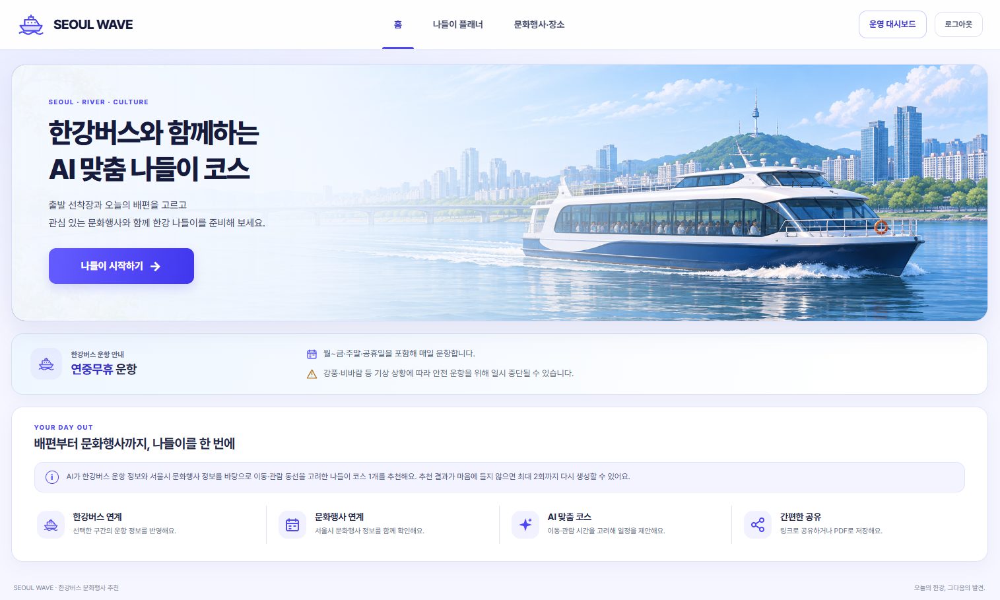
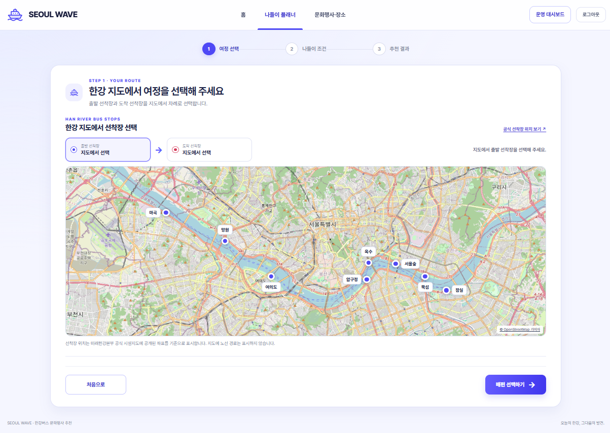
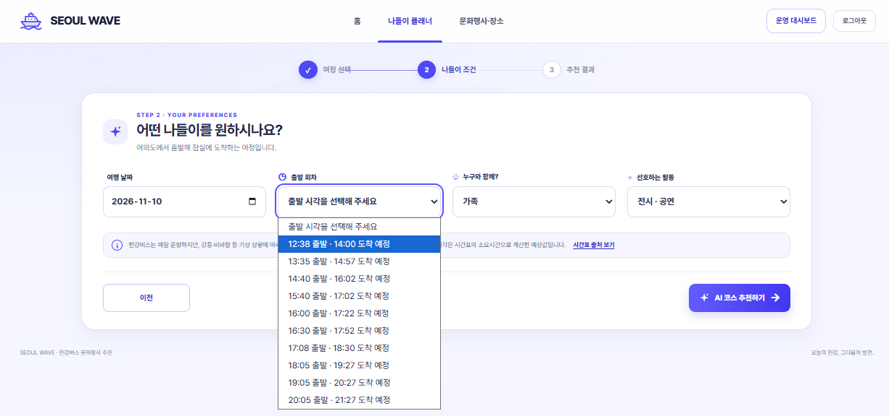
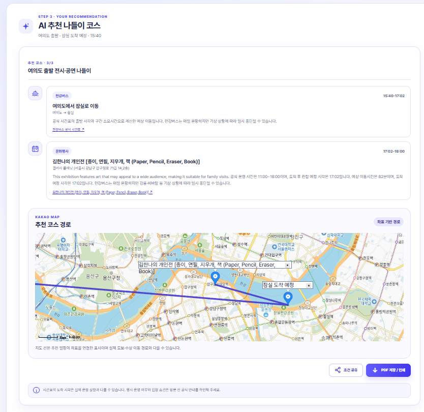
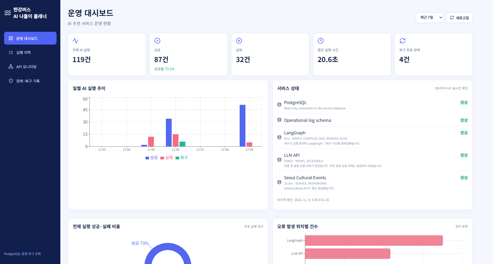
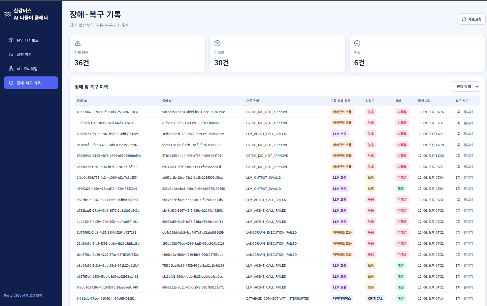
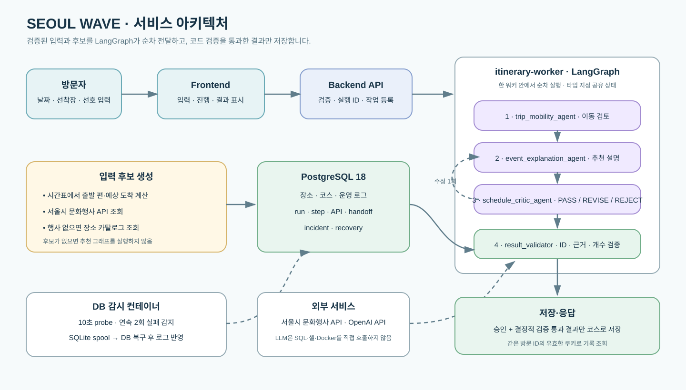
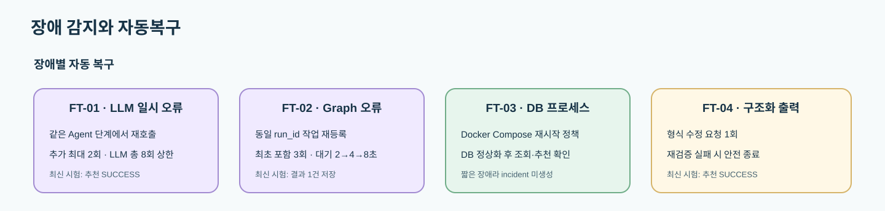
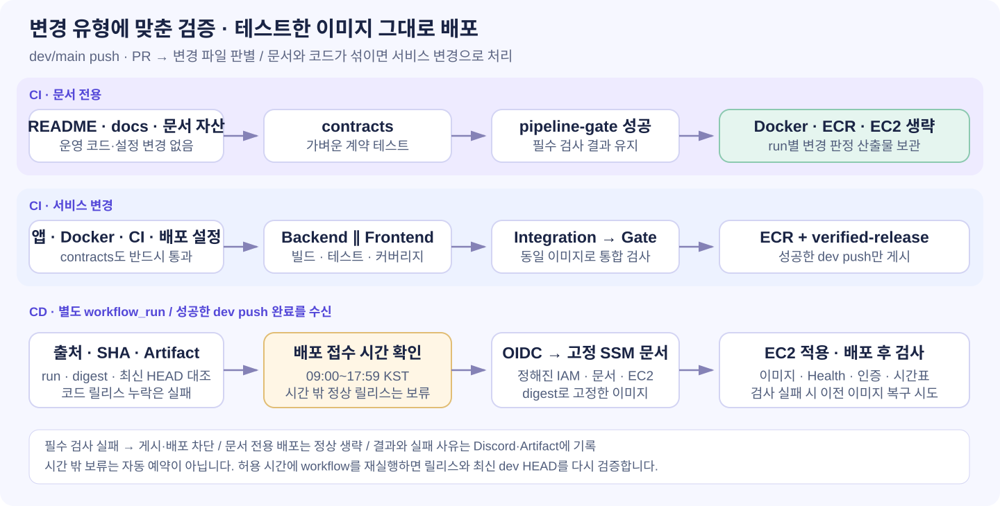

<h1>🌊 SEOUL WAVE</h1>
<h3>한강버스 AI 나들이 플래너</h3>

<strong>한강버스 시간표와 서울 문화행사를 잇는 맞춤 나들이 코스</strong>

출발 선착장과 날짜, 동행·활동을 고르면 배편과 주변 행사를 고려해 코스를 추천합니다.

  
  
  
  
  

  <a href="http://13.125.158.52/">🚀 서비스 바로가기</a> ·
  <a href="docs/itinerary-api-contract.md">📘 API 계약서</a> ·
  <a href="docs/pipeline-implementation-report.md">🛠 CI/CD 설계</a>

## 기술 구성

| 영역 | 구성 |
| --- | --- |
| 사용자 화면 | Frontend · 입력, 진행 상태, 코스 결과 |
| API | Backend · 입력 검증, 시간표·후보 조회, 작업 등록 |
| 추천 실행 | itinerary-worker · LangGraph 실행 |
| 데이터 | PostgreSQL 18 · 장소, 코스, 운영 로그 / SQLite spool · DB 장애 중 기록 보존 |
| 운영 | Docker Compose · 멀티 컨테이너 및 프로세스 재기동 |
| CI/CD | GitHub Actions, AWS ECR, GitHub OIDC, AWS SSM |
| 외부 연동 | 서울시 문화행사 API, OpenAI API |

## 팀과 역할

| 이름 | 역할 | 담당 영역 | GitHub |
| --- | --- | --- | --- |
| 김윤한 | 팀장·PM | 기획·발표·멀티에이전트 아키텍처 공동 설계 | [foundation716-bot](https://github.com/foundation716-bot) |
| 박서윤 | 서비스 백엔드 | 프로젝트 기록·백엔드 개발·멀티에이전트 아키텍처 산출물 | [seoyun-park](https://github.com/seoyun-park) |
| 배소정 | 운영 백엔드·보안 | 보안·운영·대시보드·배포 및 장애복구 보고서 | [thwjd9393](https://github.com/thwjd9393) |
| 임익현 | 프론트엔드·DevOps | React·TypeScript 개발, API 연동, AWS 배포·CI/CD, Discord 알림, 테스트·배포 문서 및 시연 | [munchkin112](https://github.com/munchkin112) |

## 주요 기능

| 기능 영역 | 제공 기능 | 결과 |
| --- | --- | --- |
| 여정 입력 | 날짜·출도착 선착장·출발 희망 시각·동행·선호 활동 입력 | 추천 요청 |
| 배편 정보 | 시간표 조회와 구간 소요시간 계산 | 예상 도착 시각 |
| 행사·장소 탐색 | 문화행사 조회, 행사 없을 때 PostgreSQL 장소 검색 | 검증된 후보 |
| AI 추천 | 이동 검토·추천 설명·일정 및 근거 검토 | 근거 기반 코스 |
| 검증·기록 | 승인, 후보·근거 ID, 추천 수 확인 및 저장 | 통과 코스와 재조회 |
| 방문 기록 | 서명 쿠키의 방문 ID와 DB 기록 대조 | 같은 브라우저에서 이어보기 |

## 서비스 흐름

**선착장 선택 → 날짜·배편·동행·활동 설정 → AI 추천 코스 확인**

<table>
  <tr>
    <th width="50%">① 지도에서 출발·도착 선착장 선택</th>
    <th width="50%">② 나들이 조건과 운항 회차 선택</th>
  </tr>
  <tr>
    <td></td>
    <td></td>
  </tr>
</table>

### ③ 이동 일정과 방문지를 한 코스로 확인

  

시간표로 예상 도착 시각을 계산하고 행사·장소 후보를 조회한 뒤, 에이전트 검토와 코드 검증을 통과한 코스를 표시합니다. 처음 추천 후 **최대 두 번 다른 코스를 생성**할 수 있고, **여정 조건 링크 공유**와 **PDF 저장·인쇄**를 지원합니다. 공유 링크는 선택 조건을 전달하며 동일한 AI 결과를 보장하지는 않습니다.

적합한 행사와 장소가 모두 없으면 추천을 임의로 생성하지 않고 조건에 맞는 방문지를 찾지 못했다고 안내합니다.

<strong>운영 화면 — 서비스 상태와 장애·복구 이력</strong>

<table>
  <tr>
    <th width="50%">운영 현황·서비스 상태</th>
    <th width="50%">오류 원인·복구 시도 추적</th>
  </tr>
  <tr>
    <td></td>
    <td></td>
  </tr>
</table>

운영 대시보드에서 실행 이력, 외부 API 응답, 장애와 복구 기록을 조회합니다. 화면의 수치에는 시험·모의 실행 기록이 포함되므로 운영 성공률이나 현재 장애 수를 뜻하지 않습니다.

캡처의 일정·수치는 촬영 시점의 예시입니다. 이미지를 누르면 원본을 볼 수 있습니다. 지도 선은 좌표를 연결한 표시이며 실제 도보·수상 경로와 다를 수 있습니다.

## 방문자 ID와 기록

서비스 접근 인증과 별개로 개인 사용자 계정 대신 방문 ID로 기록을 연결합니다. 첫 코스를 만들 때 서버가 방문 ID를 발급해 서명된 브라우저 쿠키에 담습니다. 서버는 이후 요청에서 이 ID를 DB의 만료 정보 및 연결된 코스 기록과 대조합니다. 유효한 쿠키가 유지되는 동안 같은 브라우저에서 이전 코스를 이어서 확인할 수 있습니다.

세션 전체를 DB에 저장하지는 않지만 방문 ID, 만료 정보, 코스 기록은 저장합니다.

## 멀티에이전트 아키텍처

세 개의 도메인 에이전트와 하나의 결정적 코드 검증 노드가 **하나의 워커 안에서** 실행됩니다. 별도의 LLM Supervisor가 작업을 분배하는 구조가 아니라 LangGraph의 고정 전이와 조건부 전이가 순서, 수정 루프, 실행 예산과 종료를 제어합니다.

| 노드 | 역할 |
| --- | --- |
| `trip_mobility_agent` | 검증된 시간표와 예상 도착 시각을 바탕으로 이동 근거와 불확실성을 정리합니다. |
| `event_explanation_agent` | 허용된 후보에서 최대 한 곳을 선택하고 근거가 있는 추천 설명을 작성합니다. |
| `schedule_critic_agent` | 날짜, 도착지, 시간표, 후보 및 설명을 검토하고 `PASS`, `REVISE`, `REJECT`를 판정합니다. |
| `result_validator` | Critic 승인, 후보 ID, 근거 ID, 추천 개수를 코드로 검사합니다. |

Critic이 수정을 요청하면 추천 설명 노드로 한 차례 돌아갑니다. 원래 입력, 후보와 각 단계 결과는 타입 지정 공유 상태의 별도 필드에 보존합니다. 검증에 통과하지 않은 결과는 저장하거나 사용자에게 공개하지 않습니다.

## 장애 감지와 자동복구

| 장애 | 감지·복구 주체 | 동작·시험 결과 |
| --- | --- | --- |
| FT-01 LLM 일시 오류 | Agent 노드 | 추가 재시도 최대 2회, 전체 90초·LLM 8회 제한. 추천 성공 |
| FT-02 LangGraph 오류 | 워커 | 같은 `run_id` 재등록, 최초 포함 최대 3회, 2·4·8초 대기. 추천·저장 성공 |
| FT-03 PostgreSQL 종료 | Docker Compose·DB 감시기 | `restart: unless-stopped` 재기동. 10초 probe, 연속 2회 실패 감지. 짧은 장애라 incident 미기록 |
| FT-04 구조화 응답 오류 | 출력 검증 | 형식 수정 1회 후 재검증. 추천 성공 |
| DB 연결 불가 중 로그 | 감시기 | SQLite spool에 보관 후 DB 복구 시 운영 로그 반영 |

최신 시험에서 네 유형 모두 사람의 재시작 없이 추천 성공까지 복구했습니다(**4/4, 100%**). FT-03은 감지 임계값 전에 복구되어 incident가 남지 않았습니다. incident·recovery 기록까지 확인된 감사 완결률은 **3/4, 75%**입니다. 유형별 최신 시험은 1회입니다. Healthcheck 실패만으로 컨테이너가 재시작되지는 않습니다.

## CI/CD 파이프라인

**문서는 가볍게 검증하고, 서비스 변경은 테스트한 이미지 그대로 배포합니다.**

| 변경·단계 | 수행하는 일 | 차단·생략 기준 |
| --- | --- | --- |
| README·일반 문서만 변경 | 변경 파일 판별 + 계약 테스트 + `pipeline-gate` | Docker 빌드·통합 테스트·ECR 게시·EC2 배포 생략 |
| 앱·Docker·Compose·CI·배포 설정 변경 | Backend·Frontend 검사 → 같은 이미지로 통합 검사 → 필수 gate | 실패·취소·예상 밖 생략·판별 실패 시 게시 차단 |
| 검증 이미지 게시 | 저장한 아카이브를 재빌드 없이 ECR 게시 → `verified-release` 생성 | 성공한 `dev push`만 허용. PR·main·수동 검사는 게시·배포하지 않음 |
| EC2 배포 전·후 확인 | run 출처·SHA·Artifact digest 검증 → OIDC → 고정 SSM 문서 → 서비스 검사 | 코드 변경의 산출물 누락·검증 실패는 오류. 적용 후 검사 실패 시 이전 이미지 복구 시도 |

이미지 config의 SHA-256과 ECR manifest를 대조하고 배포 참조를 digest로 고정합니다. CI는 임시 PostgreSQL 18과 합성 데이터·Mock을 사용하며 운영 API 키와 DB 비밀번호를 테스트에 사용하지 않습니다. 결과는 Discord로 통보합니다.

배포 접수 시간은 **한국 시간 09:00~17:59**입니다. 유효한 릴리스가 시간 밖에 도착하면 AWS 인증 전에 배포를 보류하고 사유를 기록합니다. 자동 예약되지는 않으며, 허용 시간에 배포 workflow를 재실행할 때 최신 `dev` HEAD와 산출물을 다시 검증합니다. 문서 전용 실행은 별도의 정상 생략 사유로 구분합니다.

[파이프라인 설계·실행 증빙](docs/pipeline-implementation-report.md) · [배포 운영 절차](docs/operations/ec2-deployment.md)

## 테스트 결과

각 테스트 집합은 목적과 실행 환경이 달라 아래 수치를 별도로 보고합니다.

| 테스트 구분 | 최신 결과 | 비고 |
| --- | --- | --- |
| 파이프라인 Backend | 67개 통과, app 실행 줄 커버리지 70.83% | 강제 기준 70% 이상 |
| 파이프라인 Frontend | 36개 통과, 줄·문장 88.14%, 함수 89.57%, 분기 77.21% | 줄·문장·함수 70%, 분기 60% 이상 |
| 파이프라인 계약 테스트 | 97개 통과 | 문서 판별·필수 gate·SHA·이미지·Artifact·배포 시간대·SSM·롤백 검증 |
| 장애복구 회귀 Backend | 74개 통과, 커버리지 73.25% | 격리 PostgreSQL 18 환경 |
| 통합 smoke | 통합 job 성공 | Nginx 프록시, 로그인, 선착장·시간표 API 및 Backend DB readiness 경로 검증 |

통합 smoke는 실제 LLM 추천 전체 E2E 검증이 아닙니다. CI의 LLM 및 서울시 API 경계 테스트는 Mock 또는 합성 응답을 사용합니다. 테스트 수는 서로 다른 집합을 합산하지 않습니다.

## 프로젝트 문서

- [팀 Notion](https://app.notion.com/p/yleeylee/SEOUL-WAVE-3702b0d658a682f0b1840178085b7e75)
- [멀티에이전트 아키텍처 설계서 Final](https://app.notion.com/p/40f2b0d658a68081a681dd70c10dc4b8)
- [배포·장애복구 보고서 Final](https://app.notion.com/p/4102b0d658a680968a4ee97e8f8d989a)
- [파이프라인 구현 결과 보고서](https://app.notion.com/p/413d5f9cfda5804e9c01c660f832217d)
