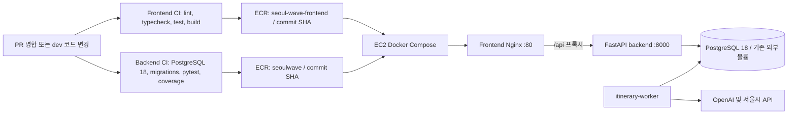

# EC2 운영 배포 준비 및 절차

이 문서는 GitHub Actions가 ECR에 올린 이미지로 기존 EC2에서 서비스를 실행할 때의 운영 절차를 정리합니다. `compose.yaml`과 개발용 `.env`는 그대로 두고, 운영에는 `compose.prod.yaml`과 EC2에만 보관하는 `.env.prod`를 사용합니다.

> 이 저장소에서 수행한 것은 운영 설정 준비와 로컬 정적 검증입니다. 현재 AWS 자격 증명과 Docker Engine에 접근할 수 없어 EC2 상태, 기존 컨테이너·볼륨, 현재 ECR 목록을 다시 확인하지 못했습니다. 아래의 이전 확인 결과는 현재 상태로 간주하지 마세요. 운영 배포와 DB 마이그레이션은 별도 승인이 필요합니다.

2026-11-06 GitHub 확인: `dev` 최신 커밋은 PR #11 병합 커밋 `0a662217736ca2f9f348d1806080cdaad87d531d`입니다. 현재 작업 기준 커밋 `84dcca49654240de8fd5fa2abf369f1ea8ff02c9`와 비교했을 때 `dev`는 병합 커밋 1개 앞서 있고 파일 차이는 없었습니다.

## 구성



프론트엔드 CI는 `dev`에 push됐을 때 검사 성공 후 SHA 태그 이미지를 업로드합니다. 백엔드 CI도 테스트용 PostgreSQL에서 마이그레이션과 pytest·커버리지를 확인하고 통과한 커밋의 이미지를 업로드합니다. 현재 배포 workflow는 EC2에 자동 배포하지 않습니다. EC2에서 Compose 실행은 별도 승인 후 수동으로 합니다.

## 확인된 이미지와 저장소

이 작업 중 GitHub Actions의 성공 기록에서 확인한 이미지입니다. ECR의 **현재 보유 여부는 AWS 인증 부재로 재조회하지 못했습니다.**

| 역할 | 저장소 | 확인된 태그 | 확인된 digest | 비고 |
| --- | --- | --- | --- | --- |
| Backend | `seoulwave` | `0a662217736ca2f9f348d1806080cdaad87d531d` | `sha256:881791b49ad472977a7b5cae79361a92535d564744de6ed2e6375eb9440bea28` | Backend CI 성공 후 업로드된 이미지 |
| Frontend | `seoul-wave-frontend` | `8cdd9a05e7d87af203ead4e90e5435891a975569` | `sha256:c149c4385e96e13ce88b0214187eb6da6a8d7a7b92d655bc78b9713f39dcafa3` | 카카오맵 키를 빌드에 전달하지 않은 기존 이미지 |

위 프론트엔드 태그는 카카오맵 표시가 필요한 운영 배포에 사용하지 마세요. CI에 빌드 인자를 추가했으므로, GitHub 저장소 변수 `VITE_KAKAO_MAP_JS_KEY`를 설정하고 그 변경을 `dev`에 반영한 뒤 새 frontend CI/ECR 업로드를 확인해야 합니다. 실제 프론트 태그는 성공한 새 실행의 commit SHA로 정합니다. `latest`를 사용하지 않습니다.

과거 EC2 셸 세션에서는 계정 `909345918351`, 리전 `ap-northeast-2`, Role `ec2-ecr-read`의 임시 자격 증명, Docker·Compose, ECR 로그인 성공을 관찰했습니다. 이후 EC2를 중지했다고 보고받았지만, 현재 인스턴스 상태·인스턴스 유형·Role 연결·보안 그룹·디스크·메모리·ECR 이미지 목록은 확인되지 않았습니다. EC2에 장기 AWS Access Key를 저장하지 말고 Instance Profile Role로 ECR pull 권한만 사용합니다.

## 운영 Compose와 데이터 보존

- `compose.prod.yaml`은 ECR 이미지 URI를 받아 씁니다. EC2에서 애플리케이션 이미지를 빌드하지 않습니다.
- PostgreSQL은 `postgres:18`이며 호스트에 5432 포트를 공개하지 않습니다.
- 운영 DB 데이터는 Compose가 새 볼륨을 만들지 않도록 `external: true` Named Volume으로 연결합니다. `.env.prod`의 `POSTGRES_VOLUME_NAME`에는 EC2에서 실제 확인한 기존 볼륨 이름을 넣어야 합니다.
- DB 이름·사용자·비밀번호는 현재 컨테이너 설정에서 확인한 값과 정확히 같아야 합니다. 기존 볼륨에 새 비밀번호를 설정해도 PostgreSQL 계정 비밀번호가 자동 변경되지 않습니다.
- PostgreSQL 공식 이미지 18부터 권장 mount 지점은 `/var/lib/postgresql`이고 `PGDATA` 기본값은 `/var/lib/postgresql/18/docker`입니다. 이 설정은 PostgreSQL 18 경로를 사용합니다. 기존 볼륨이 다른 버전·경로에서 만들어졌다면 먼저 버전과 mount를 조사해야 하며, 이 Compose로 전환한다고 데이터가 자동 이전되는 것은 아닙니다. [PostgreSQL Official Image 문서](https://hub.docker.com/_/postgres)
- DB 네트워크는 Docker 내부 전용입니다. Backend와 worker는 외부 API 호출을 위해 애플리케이션 네트워크에도 연결됩니다.
- Backend readiness는 `/ready`에서 `SELECT 1`을 실행합니다. DB 연결 확인이지 전체 테이블·LLM·외부 API·추천 worker 동작 확인은 아닙니다. `/health`는 프로세스 상태만 확인합니다.
- Worker는 기존 `python -m app.itinerary_worker` 명령으로 한 개를 실행하며 재시작 정책을 적용합니다. 코드에 worker 전용 health/heartbeat 신호가 없어 Compose healthcheck를 꾸며 넣지 않았습니다. 실행은 `docker compose ps`와 로그로 확인합니다.

## 운영 환경 변수

실제 파일은 EC2에 `.env.prod`라는 이름으로만 저장합니다. 저장소에 올리지 않습니다. 예시 파일 `.env.prod.example`의 `COPY_...` 및 `REPLACE_...` 문자열은 문서용 값이므로 그대로 배포하면 안 됩니다.

| 변수 | 설정 방법 |
| --- | --- |
| `BACKEND_IMAGE`, `FRONTEND_IMAGE` | 성공한 ECR 업로드에서 확인한 저장소와 40자리 commit SHA 태그 |
| `POSTGRES_VOLUME_NAME` | EC2에서 mount 정보를 확인해 찾은 **기존** 볼륨명 |
| `POSTGRES_DB`, `POSTGRES_USER`, `POSTGRES_PASSWORD` | 기존 PostgreSQL 설정에서 정확히 복사. 새 비밀번호를 만들거나 추측하지 않음 |
| `SESSION_SECRET` | 무작위의 32자 이상 값. 실제 비밀값은 EC2 `.env.prod`에만 저장 |
| `SITE_ACCESS_PASSWORDS` | 승인된 접속 비밀번호 목록. 쉼표로 구분하며 실제 값을 문서·로그에 쓰지 않음 |
| `SESSION_COOKIE_SECURE` | HTTPS가 사용자 브라우저까지 적용되면 `true`. 현재 운영 Nginx는 HTTP 80만 제공하므로, 직접 HTTP로 서비스하면 Secure 쿠키 로그인 세션이 유지되지 않을 수 있음. TLS 종단점 확정 후 결정 |
| `OPENAI_API_KEY`, `OPENAI_MODEL` | 승인된 OpenAI 키와 모델 식별자 |
| `SEOUL_CULTURE_API_KEY` | 서울시 문화행사 API를 사용할 경우 발급 키 |
| `FERRY_STOP_COORDINATES_JSON`, `EVENT_DESTINATION_RADIUS_KM` | worker 선택 설정. 좌표를 확정하지 않았다면 예시 기본값을 임의로 운영 확정값으로 취급하지 않음 |
| `VITE_KAKAO_MAP_JS_KEY` | 프론트엔드 이미지 **빌드 시** 사용하는 GitHub 저장소 변수. 브라우저에 전달되는 JavaScript 키이므로 Kakao 개발자 콘솔의 허용 도메인을 제한 |

`SESSION_COOKIE_SECURE=true`는 운영 안전 기본값입니다. 도메인·TLS 구성이 아직 없다면 HTTP에서 로그인 세션이 실제로 작동하지 않을 수 있습니다. TLS 앞단을 마련하거나, 시연용 HTTP 정책과 위험을 팀이 명시적으로 결정해야 합니다. 이를 임의로 `false`로 바꾸지는 않습니다.

## 배포 전 읽기 전용 확인

아래 명령은 상태 조회용입니다. 자격 증명이나 `.env` 내용은 출력하지 않습니다. 현재 접근 불가로 이 실행에서는 EC2에 명령을 보내지 않았습니다.

로컬 AWS CLI가 연결된 경우:

```powershell
aws sts get-caller-identity
aws ec2 describe-instances --region ap-northeast-2 --instance-ids i-0bedbcc72c616cdb1 --query 'Reservations[].Instances[].{State:State.Name,Type:InstanceType,PublicIp:PublicIpAddress,IamProfile:IamInstanceProfile.Arn,SecurityGroups:SecurityGroups[].GroupId}'
aws ecr describe-images --region ap-northeast-2 --repository-name seoulwave --query 'imageDetails[].{Tags:imageTags,PushedAt:imagePushedAt,Digest:imageDigest}' --output table
aws ecr describe-images --region ap-northeast-2 --repository-name seoul-wave-frontend --query 'imageDetails[].{Tags:imageTags,PushedAt:imagePushedAt,Digest:imageDigest}' --output table
```

EC2에서 SSH 접속 후, Compose 전환 전에 확인:

```bash
docker --version
docker compose version
sudo docker ps -a --no-trunc
sudo docker volume ls
sudo docker inspect <현재-PostgreSQL-컨테이너명> --format '{{json .Mounts}}'
sudo ss -ltnp
sudo systemctl status nginx --no-pager
df -h /
free -h
```

컨테이너의 전체 환경 변수, `docker inspect` 전체 JSON, `.env` 파일을 공유하지 마세요. DB 이름·사용자 및 volume의 대상 경로처럼 확인이 필요한 값만 비밀을 가리고 전달합니다. `docker volume ls`만으로 특정 볼륨이 실제 DB 데이터를 담고 있다고 판단하면 안 됩니다. 컨테이너의 `.Mounts`와 `PGDATA`, PostgreSQL 버전까지 함께 확인합니다.

## 스키마와 마이그레이션

백엔드 CI는 매 실행에서 임시 PostgreSQL 18에 `002`~`006` SQL을 순서대로 적용한 뒤 테스트합니다. 이는 EC2 운영 DB에 적용됐다는 뜻이 아닙니다. 현재 SQL에는 일반 `CREATE TABLE`/`CREATE INDEX`와 `ALTER TABLE ... ADD COLUMN`이 포함되어 있고 공통 migration ledger가 없어, 처음부터 다시 실행하면 이미 존재하는 객체에서 실패할 수 있습니다.

운영 전에는 DB 이름·테이블·컬럼·인덱스와 백업 복구 가능성을 확인하고, 각 migration이 이미 적용됐는지 대조해야 합니다. 운영 데이터 백업, 스키마 차이 보고, 승인 없이 SQL을 실행하지 않습니다. 마이그레이션은 컨테이너 시작 시 자동 실행하지 않습니다.

## 승인 후 배포 절차

이 절차는 실행 안내입니다. 현재 EC2의 기존 서비스 영향과 볼륨을 확인하고 사용자가 승인하기 전에는 실행하지 않습니다.

1. EC2 IAM Role이 두 ECR 저장소에 대해 pull 권한만 갖는지 확인합니다. 새 Access Key는 만들지 않습니다.
2. 현재 실행 중인 컨테이너·이미지·볼륨 mount·포트·Nginx 상태를 기록합니다.
3. `.env.prod.example`을 EC2 `.env.prod`로 복사하고 실제 기존 DB 값·volume 이름·approved SHA 이미지·비밀값을 채웁니다. 파일은 사용자만 읽을 수 있게 보호합니다.
4. Compose가 참조하는 이미지 URI, 환경변수 이름, external volume 이름을 검토합니다. `docker compose ... config --quiet`로 문법만 검증합니다. 출력 없는 quiet 검증을 쓰고 `config` 전체 출력을 공유하지 않습니다. 전체 설정에는 환경변수가 펼쳐질 수 있습니다.
5. 승인된 이미지 SHA를 `docker compose ... pull`로 가져옵니다.
6. 승인된 DB 백업과 스키마 점검이 끝나고, 승인된 경우에만 필요한 마이그레이션을 별도 수행합니다.
7. 중단 시간·기존 서비스 영향을 합의합니다. 기존 PostgreSQL 프로세스가 같은 데이터 볼륨을 사용 중이면 새 PostgreSQL을 동시에 시작하지 않습니다. 백업을 확인하고 기존 DB를 정상 종료한 뒤 기존 컨테이너는 보존한 상태에서 새 Compose DB가 그 볼륨을 한 번만 연결하게 합니다. 80번 포트를 기존 Nginx가 사용 중이면 승인 없이 Nginx를 중지하지 말고 포트/프록시 전환을 먼저 결정합니다.
8. 위 점검과 승인이 끝난 뒤 `docker compose -f compose.prod.yaml --env-file .env.prod up -d`로 서비스를 시작합니다.
9. `docker compose ps`의 backend `healthy` 상태가 내부 `/ready` 및 DB 연결 확인을 통과했는지 보고, frontend Nginx를 거치는 `/api/health`, 로그인 및 실제 API 호출을 확인합니다. Nginx는 `/api/health`를 `/health`로 전달하지만 `/api/ready` 경로는 제공하지 않습니다. `ready`만으로 전체 기능 성공을 주장하지 않습니다.

위 명령은 EC2 운영 변경입니다. 이 문서 작성/검증 단계에서는 실행하지 않았습니다.

## 롤백

배포 전 사용 중인 Backend·Frontend SHA와 컨테이너 상태를 기록합니다. 문제가 생기면 `.env.prod`의 Backend·Frontend 이미지 태그만 이전에 검증된 SHA로 되돌리고, 검토·승인 뒤 Compose에서 애플리케이션 서비스만 다시 생성합니다. **DB 볼륨이나 데이터는 롤백 과정에서 삭제·초기화하지 않습니다.** 스키마를 이미 바꿨다면 이미지 롤백만으로 충분하지 않을 수 있으므로 별도 복구 계획이 필요합니다.

`docker compose down -v`, `docker volume rm`, `docker system prune`, DB 초기화 SQL은 사용하지 않습니다.

## 현재 미확인 및 결정 대기

- 현재 EC2 상태·실제 타입·IP·Role 연결과 실행 중인 컨테이너/볼륨/포트
- 운영 PostgreSQL 버전·PGDATA·기존 DB 이름/사용자/비밀번호와 스키마
- 새 Kakao 키 포함 프론트 이미지 태그
- 서비스 도메인과 HTTPS/TLS 종단점, 이에 따른 Secure 쿠키 설정
- DB 백업·복구 절차와 운영 migration 이력
- `dev` 브랜치의 보호 설정: GitHub 조회에서는 보호 및 required checks가 활성화되지 않은 것으로 확인됨. 병합 차단을 원하면 별도 설정 필요
- `t3.small`의 현재 메모리·swap·여유 디스크와 4개 컨테이너의 실제 부하. 이전 셸의 1.9 GiB 메모리 관찰은 과거치라 현재 측정값으로 쓰지 않음

이 항목이 확인되고 배포 대상 SHA·DB 영향·중단 시간·TLS 방침을 검토한 뒤, 실제 운영 배포와 마이그레이션 승인 절차를 진행합니다.
